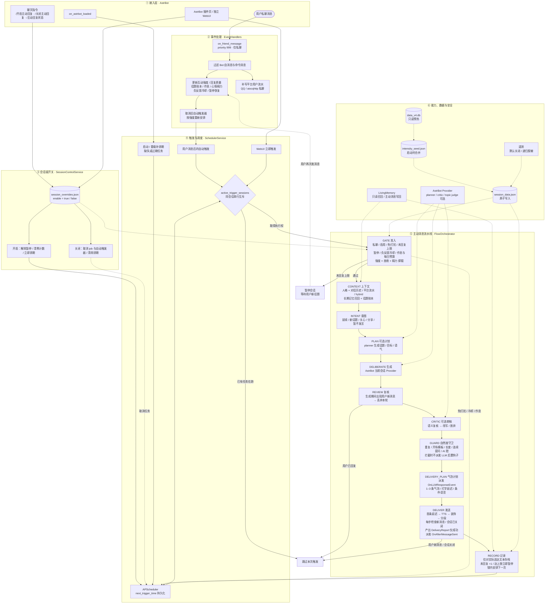

# 私聊主动消息

> 基于 [Pancakes-Labs/astrbot_plugin_proactive_chat](https://github.com/Pancakes-Labs/astrbot_plugin_proactive_chat) 的二改版本。
>
> **本版本只做私聊。** 群聊主动消息、群沉默计时器、群聊配置与相关前端入口已全部移除。
> 在「互动强度」之上新增拟人化层：作息节律、关系状态、主动意图、回复质量、自然度守卫、气泡发送计划、心情/精力，以及 LivingMemory 长期记忆接入。

---

## 这是什么

一个面向 AstrBot 的**私聊主动消息**插件。它会：

- 在你配置的私聊会话里，按对方通常活跃的时间主动找对方说话；
- 根据人格设定、最近聊天记录、平台流水、长期记忆和当前时间生成内容；
- 用「互动强度」判断现在适不适合主动开口：
  - 最近聊得火热 → 提高触发概率、缩短下一次间隔；
  - 很久没聊、回复冷淡 → 降低概率、拉长间隔；
- 用「关系状态 + 主动意图」决定这次该延续话题、开新话题、关心、分享自己、提问，还是**干脆不说话**；
- 用「回复质量」区分实质回复、提问、敷衍和明确负反馈；负反馈会暂停主动消息；
- 发送前做一次**自然度守卫**，拦截重复、过长、连续提问、AI 自指与索取情绪价值；
- 按 1–3 条气泡的节奏发送，并按概率决定是否发语音；
- 连续多次主动消息都没有回复时**临时停用**该用户，直到对方重新发来消息；
- 支持免打扰时段、每日预算、最小间隔、TTS、分段回复；
- 可选复用 **LivingMemory** 长期记忆：主动消息前召回，发送后写回；
- 自带 **AstrBot 原生插件页面**：在 AstrBot WebUI 里直接打开运行状态、互动强度、任务、通知、配置与文档；也保留独立 WebUI。

适合 QQ 官方机器人、aiocqhttp、Telegram 等支持私聊的平台。当前主要针对 **QQ 官方机器人（qq_official）** 调优。

---

## 与上游版本的核心差异

| 项目 | 上游版本 | 本版本 |
| --- | --- | --- |
| 群聊主动消息 | 支持 | **完全移除**（不注册群聊监听器，不创建群聊任务） |
| 群聊配置 | `group_settings` | 已删除 |
| 群沉默计时器 | 支持 | 已删除 |
| 配置根键 | `friend_settings` | `private_settings`（自动迁移旧键） |
| 触发概率 | 固定 | **互动强度动态概率** |
| 触发间隔 | 固定随机区间 | **互动强度动态缩放 + 作息节律调整** |
| 发送时机 | 固定免打扰 | **学习活跃时段 + 每日预算 + 最小间隔** |
| 关系状态 | 无 | **空闲 / 话题未结束 / 等待回应 / 降温 / 暂停** |
| 主动意图 | 每次必须说话 | **延续 / 新话题 / 关心 / 分享 / 提问 / 暂不发言** |
| 回复质量 | 任何回复都算回复 | **实质 / 提问 / 敷衍 / 负反馈 / 媒体** |
| 发送前检查 | 无 | **重复、长度、连续提问、AI 腔自然度守卫** |
| 表达节奏 | 单条或正则分段 | **1–3 条气泡 + 上下文延迟 + 概率性语音** |
| 长期记忆 | 无 | **可选接入 LivingMemory 召回与写回** |
| WebUI | 状态/任务/通知/文档/配置 | 新增**互动强度**页与拟人化状态展示，移除所有群聊展示 |
| 管理入口 | 仅独立 WebUI | **AstrBot 原生插件页面** + 独立 WebUI（同一份前端） |
| 历史数据 | - | 提供数据库导入工具，可从 AstrBot `data_v4.db` 预热强度 |

---

## 互动强度是怎么算的

强度分是 **0 ~ 100**，由 5 个信号加权，再乘上新鲜度与样本置信度：

| 信号 | 权重 | 含义 |
| --- | ---: | --- |
| 聊天频率 | 30% | 最近 24 小时与 7 天日均消息量 |
| 回复节奏 | 22% | 最近来回消息的中位间隔，2 分钟内接近满分 |
| 连续活跃 | 16% | 最近 14 天有聊天的天数 |
| 主动回复意愿 | 18% | 历史上对主动消息的回复率与回复速度 |
| 表达欲 | 14% | 消息长度、疑问、感叹、表情占比 |

另外两个修正：

- **新鲜度衰减**：沉默越久分数越低，默认半衰期 36 小时；
- **样本置信度**：只有一两条消息的会话会被压低，避免误判成“热聊”。

### 等级与默认映射

| 分数 | 等级 | 默认触发概率 | 默认有效间隔（基础 30–600 分钟） |
| ---: | --- | ---: | --- |
| 0–19 | 冷淡 | 约 15%–27% | 约 30–690 分钟 |
| 20–39 | 平稳 | 约 27%–43% | 约 25–594 分钟 |
| 40–54 | 热络 | 约 43%–54% | 约 21–498 分钟 |
| 55–69 | 亲密 | 约 55%–67% | 约 18–426 分钟 |
| 70–100 | 炽热 | 约 68%–95% | 约 10–354 分钟 |

分数 50 时默认概率约 **51%**；分数 75 时约 **72%**。概率未命中不会干等一整个周期，而是等待「有效最小间隔 × 20%（最低 5 分钟）」后重新判定。

> 以上是默认参数，全部可在 `private_settings.intensity_settings` 中调整。

### 用真实私聊数据校准过

本版本用一份本地 AstrBot 数据库做过离线校准（不会上传任何聊天内容）：

- 784 个私聊会话、14,600 条用户消息；
- 会话内来回消息的中位间隔为 **2 分钟**，75% 的间隔在 **5 分钟**以内，90% 在 **90 分钟**以内；
- 按“最后一条用户消息时刻”评分，峰值等级分布为：
  - 冷淡 278
  - 平稳 272
  - 热络 147
  - 亲密 82
  - 炽热 5

这说明模型能把“一次性问一句”和“长期高频聊天”区分开，而不是所有人拿同一个概率。

---

## 拟人化层

强度决定“概率和间隔”，拟人化层决定“此刻该不该说、以什么状态说、怎么说”。

### 作息节律

- 从真实消息学习对方通常活跃的 24 小时分布；
- 在活跃窗口之外不发送，顺延到下一个合适时间；
- 每日主动消息上限、两次主动消息最小间隔；
- 周末额外放宽、昼夜概率系数、固定免打扰兜底。

### 关系状态与主动意图

```text
空闲 → 开新话题 / 分享自己
话题未结束 → 延续具体话题
等待回应 → 更克制，可能暂不发言
降温中 → 轻量关心，降低频率
已暂停 → 不发送
```

在生成文本前先选择意图：延续话题、开新话题、关心、分享自己、提问，或**暂不发言**。低精力、连续未回复、负反馈都会提高“暂不发言”的权重；连续沉默有上限，不会一直消失。

### 回复质量与负反馈

| 回复 | 处理 |
|---|---|
| 实质回复 / 提问 / 媒体 | 未回复计数清零，视为重新投入 |
| “嗯”“哦”“好”“😂” | 不清零，进入降温，避免越聊越尴尬 |
| “别发了”“在忙”“不要打扰” | 暂停主动消息并进入冷却，等待用户之后重新开启话题 |

反馈会按“小时桶 × 意图”统计，用于下次意图选择，而不是只看总体回复率。

### 自然度守卫

发送前拦截：

- 与最近主动消息高度重复；
- 过长、连续提问；
- “作为 AI”“怎么还不回我”“是不是讨厌我”等 AI 自指/索取情绪价值；
- 客服腔与自定义禁用正则。

命中后可以调用一次轻量 LLM 改写；改写仍不合格则放弃本轮并重排期。

### 气泡发送计划

把回复拆成 1–3 条气泡，按字数与标点决定切分，按上下文决定每条之间的延迟；语音只在设定概率命中时尝试，不再“启用 TTS 就每条都发”。

### 心情与精力

每个会话维护轻量的精力/心情/活动状态：深夜更低、连续未回复更低、负反馈更低；低精力时降低主动概率并缩短表达。状态会写入提示词。

### 开放话题与话题账本

长期事实记忆交给 LivingMemory；插件自己维护一份短期工作记忆：

- 用户提到的“明天面试 / 下周考试 / 等会到家”等计划与事件；
- 助手问过但用户还没回答的问题；
- 最近话题与轻量表达画像（平均长度、提问/表情比例）。

有未闭环话题时，会提高“延续话题/关心”的意图权重，并把 `<topic_ledger>` 注入提示词；用户回应后自动闭环，超过保留天数自动关闭。

### 多阶段生成（可选）

默认仍是单阶段生成；开启后可启用：

```text
planner（规划） → writer（现有 LLM） → critic（语义审稿）
```

- planner 生成话题/目标/语气/避免事项；
- critic 在发送前判断是否自然、重复、像客服；不通过可改写或放弃；
- 任一阶段失败都会自动降级，不影响主流程。

### 长期记忆（LivingMemory）

可选接入已安装的 LivingMemory：

- 生成前用最近对话 + 关系状态/意图召回长期记忆；
- 召回结果作为只读事实块注入提示词；
- 主动消息发送后写回其会话库；
- 未安装或未初始化时自动降级，不影响主流程。

### 离线回放

`tools/replay_humanization.py` 可以用 AstrBot 数据库的私聊时间线离线评估策略：发送次数、概率未命中、暂停、负反馈/敷衍比例、回复率和发送时段分布。数据库只读打开。

详见 [docs/humanization.md](docs/humanization.md)。

---

## 快速开始

### 1. 安装

把本目录放到 AstrBot 的插件目录（通常是 `AstrBot/data/plugins/`），在 AstrBot WebUI 的插件管理里重载。

依赖：

- AstrBot `>= 4.24.0`
- `apscheduler >= 3.11.3, < 4`
- `aiofiles`、`fastapi`、`uvicorn`（通常 AstrBot 已内置）

### 2. 获取私聊 UMO

UMO 格式：

```text
{platform_id}:{message_type}:{target_id}
```

私聊的 `message_type` 必须是 `FriendMessage`（部分平台为 `PrivateMessage`）。例如：

```text
qq_official:FriendMessage:0A1B2C3D4E5F60718293A4B5C6D7E8F9
```

获取方式：

- 让目标用户私聊机器人，查看 AstrBot 日志里的 `unified_msg_origin`；
- 或使用 AstrBot 的 `/sid` 指令（若已安装对应命令插件）；
- 在 WebUI 的会话列表里复制 UMO。

### 3. 配置

在 AstrBot 插件配置或本插件 WebUI 的「配置管理」中：

1. 打开 `private_settings.enable`；
2. 把私聊 UMO 填入 `private_settings.session_list`；
3. 按需调整 `schedule_settings`（基础间隔、免打扰、未回复上限）；
4. `intensity_settings` 默认已开启，通常无需改动；
5. `humanization_settings` 默认开启作息、状态、反馈、守卫、气泡计划和心情状态；
6. 如果安装了 LivingMemory，`memory_integration_settings` 会自动尝试接入，无需额外配置。

最小示例：

```yaml
private_settings:
  enable: true
  session_list:
    - "qq_official:FriendMessage:0A1B2C3D4E5F60718293A4B5C6D7E8F9"
  schedule_settings:
    min_interval_minutes: 30
    max_interval_minutes: 600
    quiet_hours: "1-7"
    max_unanswered_times: 4
  intensity_settings:
    enable: true
  humanization_settings:
    rhythm_settings:
      daily_proactive_limit: 6
      min_gap_minutes: 30
    memory_integration_settings:
      enable: true
```

### 4. 验证

让目标用户给机器人发一条消息。之后在 WebUI：

- 「运行状态」能看到已跟踪会话与自动触发计时器；
- 「互动强度」能看到该用户的分数、概率与有效间隔；
- 「任务管理」能看到下一次主动消息任务。

也可以点击任务卡片的「立即触发」做一次手动测试（手动触发会跳过概率判定与免打扰时段；手动触发与定时任务互斥，同一会话不会并发发送）。

---

## 管理界面

### 方式一：AstrBot 原生插件页面（推荐）

重载插件后，在 AstrBot WebUI 的「插件管理」里打开本插件详情页，即可看到「主动消息管理台」视图。页面直接嵌入 AstrBot，跟随 Dashboard 的亮/暗主题，无需单独端口或二次登录。

新增或修改 `views/` 下的页面后，需要在 AstrBot 里重载插件，Dashboard 才能发现新视图。

### 方式二：独立 WebUI

默认地址：`http://127.0.0.1:4100`（由 `web_admin` 配置控制）。

| 页面 | 作用 |
| --- | --- |
| 运行状态 | 服务状态、调度概览、互动强度概览、暂停原因、长期记忆连接状态、自动触发计时器 |
| 互动强度 | 每个私聊的强度分、等级、概率、有效间隔、关系状态、意图、心情/精力、活跃时段、回复质量、最近判定 |
| 任务管理 | 下一次执行时间、倒计时、关系状态/意图/心情徽章、立即触发、取消、重新调度 |
| 通知中心 | 远端通知同步 |
| 文档浏览 | 直接查看本仓库的 README 与 docs |
| 配置管理 | 全局配置 + 单会话差异配置（只展示私聊字段，含 `humanization_settings`） |

两种入口共用 `views/proactive-chat/` 下的同一份前端源码：内嵌模式通过 AstrBot bridge 调 API、用 10 秒轮询刷新；独立模式走 HTTP + WebSocket 和登录 token。

> React / ReactDOM / MUI / Emotion / marked / DOMPurify / mermaid 已全部放在 `views/proactive-chat/lib/` 随插件本地分发，离线、内网或 CDN 不可达时页面仍可加载。源码仓库额外用本地 Babel Standalone 编译 JSX；Release 包会预编译 JSX 并移除 Babel 依赖。

---

## 配置说明（摘要）

完整字段见 [docs/configuration.md](docs/configuration.md)。

### 会话级开关指令

不需要改配置文件，直接在当前私聊发送：

| 指令 | 作用 |
| --- | --- |
| `/开启主动回复` | 开启当前私聊的主动回复，并立即安排下一次 |
| `/关闭主动回复` | 关闭当前私聊的主动回复，取消已有排期 |
| `/主动回复状态` | 查看开关、下一次触发与未回复次数 |
| `/主动回复 开` / `/主动回复 关` / `/主动回复 状态` | 同上 |

开关写入 `session_overrides.json` 的会话级 `enable`，优先级高于全局 `session_list`。因此即使 UMO 不在 `session_list`，也可以用 `/开启主动回复` 单独开启某个私聊；`/关闭主动回复` 也可以单独关闭白名单里的某个会话。

### `private_settings`

| 字段 | 默认 | 说明 |
| --- | --- | --- |
| `enable` | `true` | 私聊主动消息总开关 |
| `session_list` | `[]` | 私聊 UMO 白名单 |
| `proactive_prompt` | 内置 | 主动消息提示词，支持占位符 |
| `context_settings` | - | 对话历史 / 平台流水 / 混合上下文 |
| `schedule_settings` | - | 基础间隔、免打扰、未回复上限 |
| `auto_trigger_settings` | - | 插件启动后长时间无消息时的自动触发 |
| `tts_settings` | - | 语音合成 |
| `segmented_reply_settings` | - | 分段回复 |
| `pause_settings` | - | 未回复暂停与 LLM 话题判定 |
| `intensity_settings` | - | 互动强度参数 |
| `humanization_settings` | - | 作息、状态、反馈、守卫、气泡、心情、开放话题、多阶段生成与长期记忆 |

### 提示词占位符

- `{{current_time}}`：当前时间
- `{{unanswered_count}}`：连续未回复次数
- `{{intensity_score}}`：互动强度分
- `{{intensity_tier}}`：强度等级（冷淡/平稳/热络/亲密/炽热）
- `{{intensity_probability}}`：本轮触发概率
- `{{conversation_state}}`：关系状态（空闲/话题未结束/等待回应/降温中/已暂停）
- `{{intent}}` / `{{intent_brief}}`：本轮意图与写作 brief
- `{{persona_state}}`：心情、精力与当前活动
- `{{active_hours}}` / `{{daily_budget}}`：活跃时段与今日预算
- `{{memory_block}}`：长期记忆召回块

### `intensity_settings`

| 字段 | 默认 | 说明 |
| --- | ---: | --- |
| `enable` | `true` | 启用强度调节 |
| `probability_min` | `15` | 强度 0 分时的触发概率（%） |
| `probability_max` | `95` | 强度 100 分时的触发概率（%） |
| `probability_gamma` | `115` | 概率曲线陡峭度（%，100=线性） |
| `interval_scale_hot` | `35` | 强度 100 分时间隔缩放（%，35=缩短到 35%） |
| `interval_scale_cold` | `115` | 强度 0 分时间隔缩放（%） |
| `interval_gamma` | `100` | 间隔曲线陡峭度（%） |
| `min_interval_floor_minutes` | `8` | 无论多热，最小间隔下限 |
| `response_window_hours` | `6` | 发出主动消息后多久内回复算“已回复” |
| `recency_half_life_hours` | `36` | 热度半衰期 |
| `apply_to_auto_trigger` | `true` | 自动触发是否也走强度调节 |
| `prompt_context` | `true` | 是否把强度写入提示词 |
| `skip_retry_ratio` | `20` | 概率未命中后的重试比例（%） |
| `min_skip_retry_minutes` | `5` | 最短重试等待 |

### `humanization_settings`

| 子项 | 作用 |
| --- | --- |
| `rhythm_settings` | 学习活跃时段、每日预算、最小间隔、昼夜系数 |
| `state_settings` | 关系状态机、等待/降温窗口、是否允许“暂不发言” |
| `feedback_settings` | 回复质量识别、负反馈冷却、敷衍是否清零 |
| `guard_settings` | 重复/长度/连续提问/AI 腔检查与一次改写 |
| `delivery_plan_settings` | 气泡数量、拆分阈值、延迟、语音概率 |
| `persona_settings` | 基础精力、低精力阈值与概率降幅 |
| `memory_integration_settings` | LivingMemory 召回/写回/超时 |
| `conversation_memory_settings` | 开放话题、话题账本、轻量画像、跟进权重 |
| `generation_settings` | planner / critic 多阶段生成开关与超时 |

完整说明见 [docs/humanization.md](docs/humanization.md)。

---

## 从 AstrBot 数据库预热强度（可选）

插件运行时只统计**启用之后**的消息。如果你希望新装插件就了解老用户的互动习惯，可以导入历史：

```bash
python tools/import_astrbot_history.py \
  --db /path/to/AstrBot/data/data_v4.db \
  --report ./intensity_report.json
```

先看报告，确认分数与等级合理后，再写入插件数据：

```bash
python tools/import_astrbot_history.py \
  --db /path/to/AstrBot/data/data_v4.db \
  --data-dir /path/to/AstrBot/data/plugin_data/astrbot_plugin_proactive_chat \
  --min-messages 20 \
  --write
```

- 数据库以只读模式打开；
- 只读取 `FriendMessage` / `PrivateMessage` 会话；
- 写入前会把 `session_data.json` 备份为 `.json.bak`；
- 建议配合 `--min-messages`，只给真正聊过的用户做种子。

详细说明见 [docs/import-history.md](docs/import-history.md)。

---

## 测试与验证

```bash
# 全部单元 / 集成测试
python -m pytest tests -q

# 真实 AstrBot 集成测试（AstrBot 4.29.4 源码；也可设置 ASTRBOT_SRC）
python -m pytest tests/test_real_astrbot_integration.py -q

# Python 语法检查
python -m compileall -q core main.py utils tools tests

# 强度模拟（不需要 AstrBot 运行时）
python tools/simulate_intensity.py --all

# 前端 JSX 语法检查（需要 Node + @babel/parser）
node tools/check_jsx.js

# iframe bridge 协议测试（需要 Node）
node tests/integration/bridge_protocol_test.js
```

测试覆盖：

- 强度评分、衰减、概率与间隔映射；
- 主动消息回复结算（按时回复 / 超时未回复 / 统计窗口）；
- GATE 概率判定、手动触发绕过、自动触发开关；
- 作息学习、活跃窗口、每日预算、最小间隔、免打扰；
- 关系状态转移、意图权重、反馈统计、连续沉默上限；
- 回复质量分类、负反馈暂停、敷衍保留计数；
- 自然度守卫的重复/长度/提问/AI 腔与一次改写；
- 人格精力曲线与低精力概率降幅；
- 气泡发送计划、概率性语音与富媒体保留；
- 开放话题提取、话题账本、画像与 TTL 清理；
- planner / critic 多阶段生成、JSON 解析、失败降级与改写；
- 敷衍/负反馈不结算主动回复率、cooldown 合并策略；
- 离线回放工具的私聊过滤、质量统计与报告；
- LivingMemory 召回、作用域、格式化与写回去重；
- 完整流水线集成（GATE → INTENT → CONTEXT → PLAN → DELIBERATE → REVIEW → GUARD → CRITIC → DELIVERY_PLAN → DELIVER → RECORD）；
- 群聊 UMO 在配置、任务、事件层的全链路拒绝；
- 调度器强度修正与强制重试；
- 数据库导入、状态构建与种子写入；
- 真实导入 `main.py` + AstrBot `StarHandlerRegistry`，验证 `plugin_set` 过滤与 `OnAstrBotLoadedEvent` 豁免；
- 真实 `Context.register_web_api` / `PluginRequest` 页面路由注册与调用；
- 真实 `bridge.js` 的 22 条 iframe bridge 路径映射；
- 同一会话定时/手动触发并发互斥、发送窗口内用户回复中止气泡、收尾阶段竞态。

---

## 运行时行为

```text
私聊消息
  └─ 记录互动强度（频率/节奏/表达/回复）
  └─ 识别回复质量（实质/提问/敷衍/负反馈/媒体）
  └─ 更新作息分布、关系状态、心情/精力
  └─ 负反馈 → 暂停；敷衍 → 保留未回复计数
  └─ 取消旧的自动触发
  └─ 按强度与作息安排下一次主动消息

定时触发
  └─ GATE：私聊？启用？免打扰？未回复上限？每日预算？最小间隔？
  └─ GATE：按强度、昼夜与精力掷骰（手动触发跳过）
  └─ CONTEXT：人格 + 对话历史 / 平台流水（含相对时间） + 长期记忆召回 + 话题账本
  └─ INTENT：结合最新语境选择 延续 / 新话题 / 关心 / 分享 / 提问 / 暂不发言
  └─ PLAN（可选）：planner 结合人格摘要生成话题/目标/语气/避免事项
  └─ DELIBERATE：writer 注入自然态引导、意图、精力、时间与计划，调用 LLM
  └─ REVIEW：生成期间用户是否又发消息？
  └─ CRITIC（可选）：语义级审稿，不通过则改写或放弃
  └─ GUARD：重复 / 套路开场 / 过长 / 连续提问 / AI 腔检查，必要时改写（含对改写结果的复检）
  └─ DELIVERY_PLAN：1–3 条气泡、口语化句尾与按打字节奏的延迟，过滤不适合语音的文本后概率发语音
  └─ DELIVER：装饰 / 发送，按实际送达气泡生成 DeliveryReport
  └─ RECORD：仅对实际送达内容存档、未回复 +1（若达上限立即暂停并清除排期）、写回长期记忆、更新状态、按强度与作息排下一次
```

群聊消息不会进入上述任何一步。

---

## 连续未回复自动暂停

适用场景：Bot 连续主动找对方，但对方一直没有回应。

规则：

1. 每成功送达一次主动消息，未回复计数 +1；
2. 达到 `schedule_settings.max_unanswered_times`（默认 4）后**立即**：
   - 写入 `proactive_paused` 暂停标记；
   - 清除下一次触发时间与调度字段；
   - 取消当前任务和自动触发计时器；
   - **不再继续排期**，不会再多发一轮或每隔一段时间反复“到点即停”；
3. 暂停后不会自动发送任何主动消息（重启恢复、自动触发及管理端重新调度也会拦截）；
4. 对方**再次发来消息**时，按 `pause_settings.resume_mode` 决定是否恢复：
   - `llm_topic`（默认）：先用一次轻量 LLM 判断这条消息是否是新话题；
     - 新话题、问候、分享新事件、明确想继续聊 → 恢复；
     - 继续旧话题、抱怨 Bot 不回、无意义单字，或纯图片/表情包等非文本消息 → **保持暂停**；
   - `any_message`：任何用户消息都立即恢复；
5. 恢复时清除暂停标记、未回复计数归零，并按互动强度重新安排下一次主动消息；
6. 也可以在 WebUI「运行状态 → 未回复暂停」中手动「恢复并重新排期」。

此外，`feedback_settings` 会把明确负反馈（“别发了”“在忙”“不要打扰”）也视为暂停原因 `negative_feedback`，并写入冷却截止时间；冷却期内即使重新开启话题也不会立刻主动，管理端手动恢复会清除冷却。敷衍回复（“嗯”“哦”“好”）不会清零未回复计数，而是进入降温状态。

`max_unanswered_times = 0` 表示不限制、不暂停。

LLM 判定失败/超时默认会恢复（`pause_settings.fallback_resume_on_error=true`），避免用户被永久卡住；也可以关闭它，让失败时保持暂停。

暂停状态会持久化，插件重启后仍然保持；只有用户新消息通过判定或管理端手动恢复才会解除。

---

## 兼容性与迁移

- 旧版 `friend_settings` 会自动迁移为 `private_settings`；
- 旧版 `group_settings` 不会再被读取，可以手动删除；
- 旧 `session_data.json` 中的群聊键会在恢复任务时被跳过并清理调度字段；
- 会话级覆写文件 `session_overrides.json` 仍然兼容，新增 `intensity_settings` 与 `humanization_settings` 可覆写。

详见 [docs/migration-v2.md](docs/migration-v2.md)。

---

## 常见问题

**Q：为什么加了好友却一直不主动说话？**
A：先确认当前 bot 的配置里 `plugin_set` 包含 `astrbot_plugin_proactive_chat`（或在 AstrBot bot 配置页勾选本插件）。AstrBot 会按 bot 级插件集过滤私聊消息监听器；漏选时插件仍能启动和发主动消息，但用户的回复不会被记录。随后确认 UMO 已加入 `session_list`、`private_settings.enable=true`，并且当前不在免打扰时段；再看「互动强度」页的概率和「任务管理」里的下一次时间。

**Q：为什么强度一直是 0？**
A：强度只统计启用后的私聊消息。让对方发几条消息，或用导入工具预热历史。

**Q：为什么概率 90% 还是没有立刻发？**
A：概率判定只在定时任务触发时执行，且要同时通过免打扰、未回复上限等 GATE 条件。手动触发会跳过概率判定与免打扰时段，但仍受会话禁用、未回复暂停和并发执行限制。

**Q：会不会在群里发消息？**
A：不会。本版本没有注册任何群聊监听器，配置、调度、事件构造、前端都只接受私聊 UMO。

**Q：自然度守卫拦截了文本，为什么还收到 TTS？**
A：这通常是因为其他 TTS 插件在 `on_llm_response` 钩子里直接发送语音。本版本已把 `OnLLMResponseEvent` 推迟到自然度守卫通过之后派发；守卫拦截时不会再触发 TTS。若你使用的 TTS 插件挂在 `on_decorating_result`，它也只会在文本真正发送前执行。

**Q：平台流水里为什么看不到用户消息？**
A：AstrBot 4.x 默认只给群聊和 webchat 私聊写平台流水。本插件会为启用的私聊补写用户消息；升级后让用户再发一条消息即可看到。主动消息本身也会以 Bot 身份写入同一条流水。

**Q：遥测默认开启吗？会上传提示词吗？**
A：默认关闭。即使用户主动开启，发送前也会递归删除任意层级的提示词、密码、Token、密钥与会话列表原文，只保留脱敏后的统计配置。

**Q：QQ 官方机器人私聊 UMO 是什么样？**
A：`qq_official:FriendMessage:<用户 openid>`。平台 ID 以你 AstrBot 里实际配置的机器人名为准；数据库里也可能显示为 `qq_offficial`（历史拼写），以日志/`/sid` 输出为准。

---

## 架构图

下图是当前版本的完整运行架构，覆盖接入、事件处理、会话级开关、调度、主动消息流水线与数据层。Mermaid 源码可直接在 GitHub、VS Code、Typora 等渲染器中查看。



更完整的阶段职责、并发与持久化不变量见 [docs/architecture.md](docs/architecture.md)。

---

## 项目结构

```text
core/
  domain/intensity.py              # 纯强度模型（无框架依赖）
  domain/humanization.py           # 回复分类/状态/意图/发送计划纯逻辑
  services/intensity_service.py    # 强度状态、回复结算、概率决策
  services/rhythm_service.py       # 作息学习、每日预算、最小间隔
  services/conversation_state_service.py # 关系状态、反馈统计、意图选择
  services/persona_state_service.py      # 心情/精力/活动状态
  services/guard_service.py        # 发送前自然度守卫与一次改写
  services/conversation_memory_service.py # 开放话题/话题账本/画像
  services/generation_service.py   # planner / critic 多阶段生成
  services/memory_bridge.py        # LivingMemory 可选桥接
  services/scheduler_service.py    # 私聊调度 + 强度/作息修正
  features/gating_feature.py       # 私聊准入 + 概率掷骰
  features/intent_feature.py       # INTENT 阶段
  features/plan_feature.py         # PLAN 阶段（planner）
  features/guard_feature.py        # GUARD 阶段
  features/critic_feature.py       # CRITIC 阶段
  features/delivery_plan_feature.py# 气泡发送计划
  console/state_builder.py         # WebUI 状态/强度/拟人化载荷
  console/page_api.py              # AstrBot 插件页面 bridge API
views/proactive-chat/              # 前端源码（AstrBot 插件页面 + 独立 WebUI 共用）
.astrbot-plugin/i18n/              # 插件页面标题/描述国际化
tools/                             # 数据库导入 / 强度模拟 / 离线回放 / JSX 检查
docs/                              # 配置、强度、拟人化、QQ 官方、迁移文档
tests/                             # pytest 单元与集成测试
```

---

## 致谢与许可

- 原项目：[Pancakes-Labs/astrbot_plugin_proactive_chat](https://github.com/Pancakes-Labs/astrbot_plugin_proactive_chat)，作者 DBJD-CR；
- 本二改版本保留原项目许可证（见 [LICENSE](LICENSE)）；
- 互动强度模型、私聊化改造、WebUI 强度页与测试为本版本新增；
- 拟人化层（作息、关系状态、主动意图、回复质量、自然度守卫、气泡发送计划、心情/精力）与 LivingMemory 接入为本版本新增。
