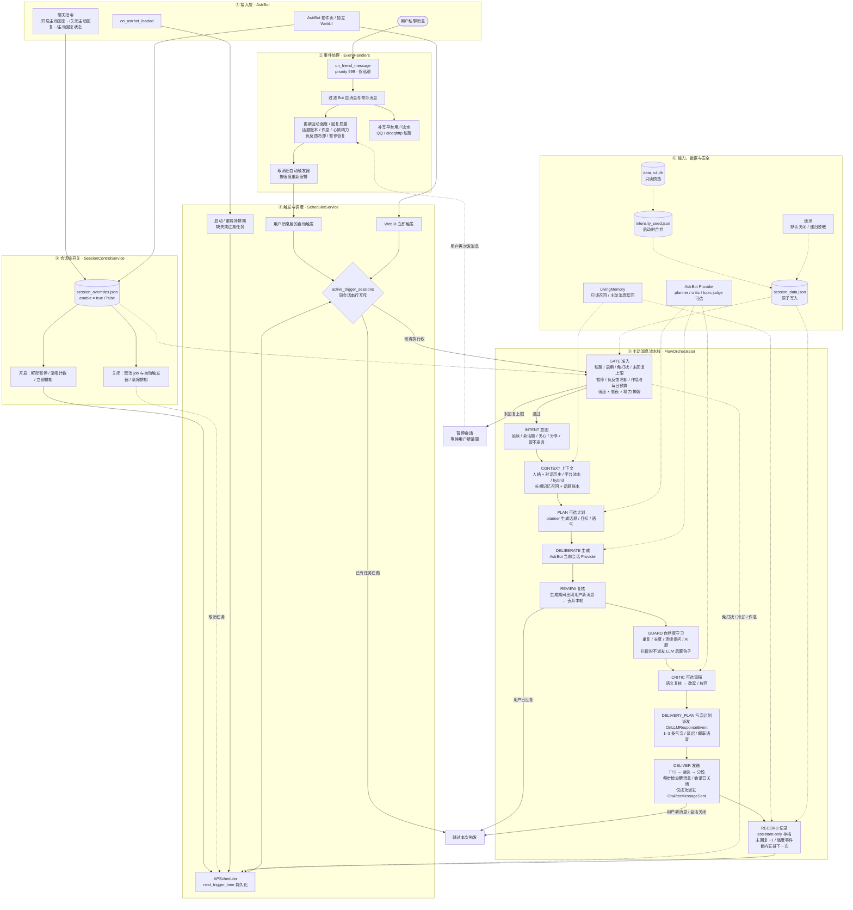

# 架构

本插件只处理私聊。群聊消息不会进入任何状态、调度或发送路径。

下图是当前版本的完整运行架构：AstrBot 接入 → 事件处理 → 会话级开关 → 调度 → 主动消息流水线 → 数据与外部能力。

## 触发来源

| 触发 | 入口 | 行为 |
| --- | --- | --- |
| 定时任务 | APScheduler + `next_trigger_time` | 到点执行；插件重启后对缺失或过期任务重新排期 |
| 自动触发 | 用户私聊消息后的计时器 | 用户刚聊过时，按强度与作息安排一次机会；新消息会取消旧计时器 |
| 手动触发 | WebUI「立即触发」 | 跳过免打扰与强度掷骰；仍受会话禁用、未回复暂停、并发互斥限制 |

三个来源共用 `active_trigger_sessions`：同一会话同一时刻只允许一条流水线执行。

## 流水线阶段

| 阶段 | Feature | 做什么 | 终止 / 重排 |
| --- | --- | --- | --- |
| GATE | `gating_feature.py` | 私聊、启用、免打扰、未回复上限、暂停、负反馈冷却、作息窗口、每日预算、强度 × 昼夜 × 精力掷骰 | 免打扰/冷却/作息 → 重排；未回复上限 → 暂停；非私聊 → 终止 |
| INTENT | `intent_feature.py` | 结合关系状态、精力、开放话题选择延续 / 新话题 / 关心 / 分享 / 暂不发言 | 「暂不发言」→ 短间隔重排 |
| CONTEXT | `conversation_source.py` | 汇总人格、对话历史 / 平台流水 / hybrid、长期记忆召回、话题账本 | 继续 |
| PLAN | `plan_feature.py` | 可选 planner，生成话题 / 目标 / 语气 / 避免事项；异常自动降级 | 继续 |
| DELIBERATE | `prompt/single_prompt.py` | 拼装提示词，调用 AstrBot 当前会话 Provider | 继续 |
| REVIEW | `review_feature.py` | 生成期间出现用户新消息或插件正在终止 → 丢弃本轮 | 终止 |
| GUARD | `guard_feature.py` | 重复、过长、连续提问、AI 腔检查；可改写文本；拦截时只重排，不派发 LLM 后置钩子 | 拦截 → 重排 |
| CRITIC | `critic_feature.py` | 可选语义审稿；不通过则改写或放弃 | 放弃 → 重排 |
| DELIVERY_PLAN | `delivery_plan_feature.py` | 守卫与审稿通过后才派发 `OnLLMResponseEvent`，再把文本拆成 1–3 条气泡并决定是否语音 | 钩子终止 → 终止 |
| DELIVER | `deliver/split_delivery.py` | TTS → 装饰钩子 → 分段发送；每个气泡前检查用户新消息与会话开关 | 新消息/已关闭 → 放弃；发送失败 → 重排 |
| RECORD | `record/history_writer.py` | assistant-only 存档、未回复 +1、强度/作息/关系/人格状态记录、锁内安排下一次 | 继续 |

## 关键不变量

1. **单会话串行**：定时、自动、手动触发都先占用 `active_trigger_sessions`；手动触发还会登记 `manual_trigger_sessions`，避免重复点击。
2. **发送窗口多重检查**：REVIEW、发送前、气泡等待、分段发送、收尾锁内都会检查用户是否已回复；会话被指令关闭时立即中止。
3. **TTS 不抢跑**：`OnLLMResponseEvent` 延迟到 GUARD / CRITIC 之后、发送计划之前派发；守卫拦截时不会触发其他 TTS 插件。改写后的文本会先同步到 `LLMResponse.completion_text`。
4. **只存档 assistant**：主动提示词不再伪装成 user 消息写入对话历史；有数据库时直接追加 assistant 记录，无数据库时回退占位。
5. **调度可恢复**：`next_trigger_time`、强度与未回复计数持久化；重启或重载后补排期，不会永久沉默。
6. **会话级开关**：`/开启主动回复`、`/关闭主动回复`、`/主动回复状态` 写入 `session_overrides.json` 的 `enable`，不依赖全局 `session_list`，也不需要改配置文件。
7. **强度种子独立**：数据库预热写入 `intensity_seed.json`，插件启动时只填充没有运行时事件的会话，避免运行中插件用旧内存覆盖导入结果。
8. **遥测默认关闭**：即使开启，也会递归删除任意层级的提示词、密码、Token、密钥与会话列表原文，只保留脱敏统计。

## 数据文件

| 文件 | 作用 |
| --- | --- |
| `session_data.json` | 会话状态、强度事件、未回复计数、下一次触发；原子写入 |
| `intensity_seed.json` | 从 AstrBot 数据库预热的历史强度；启动时合并 |
| `session_overrides.json` | 会话级配置覆盖，包括 `enable` 开关与强度/拟人化覆写 |
| `data_v4.db` | AstrBot 自身数据库；导入工具以 `mode=ro` 只读打开，只读取私聊会话 |

## 外部能力

- **AstrBot Provider**：聊天主流程使用当前会话已配置的 Provider；`topic_judge_provider_id`、`planner_provider_id`、`critic_provider_id` 可选专用 Provider。
- **LivingMemory**：可选桥接；召回只读，主动消息发送成功后通过其接口写回，未安装时自动降级。
- **平台流水**：QQ / aiocqhttp 私聊会补写用户消息，保证 `conversation` 视图能看到双方内容。

## 安全边界

- 没有注册任何群聊监听器；配置、调度、事件构造、前端都只接受私聊 UMO。
- 独立 WebUI 在无密码时只监听回环地址，禁止绑定公网网卡。
- 管理端手动触发与页面 API 只暴露必要的会话操作，不返回提示词或密钥原文。
